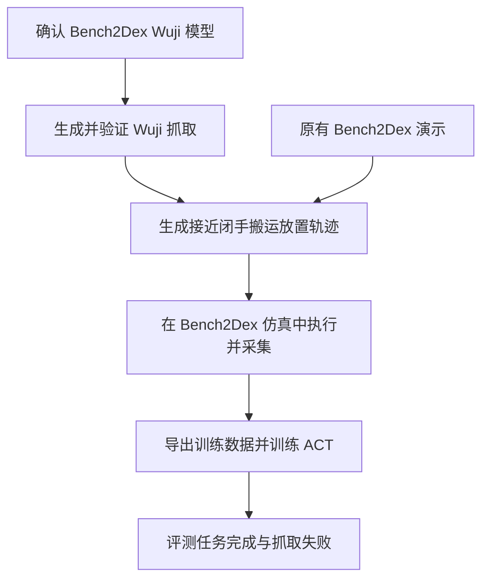

# Wuji 一代数据集与 Bench2Dex 任务迁移需求

状态：需求草案，功能尚未实现。更新日期：2026-10-13。

以 Bench2Dex 实际评测的 Wuji 一代手模型为目标，在 Dexonomy 中生成经过物理验证的抓取数据，再将抓取补成可执行的双臂任务演示，用于训练并评测 Bench2Dex 策略。首个任务为 27 球类装箱，第二个任务为 21 调味品装箱。第一版用 ACT 验证数据收益，之后再扩展到 GR00T。

本需求中的下游项目是 Bench2Dex 灵巧操作基准。新增流程由 Dexonomy 管理数据生成、验证、清单与实验配置，复用 Bench2Dex 的机器人、任务、采集和评测接口。

## 目标与研究问题

核心问题是：在训练输入和数据量可比较的条件下，抓取类别与接触关系引导的 Wuji 演示，是否比原有演示或普通演示扩增更能提高完整任务成功率，尤其是物体位置、朝向和桌高变化后的表现。

需要分别回答三个问题：Wuji 能否执行生成的抓取；这些抓取能否接入搬运与放置轨迹；生成数据能否改善学习策略。运动学误差、局部抓取成功和完整任务成功分别报告，任何一项都不能代替另外两项。

第一版交付应能复现以下流程：

## 首版范围

| 项目 | 要求 |
| --- | --- |
| 目标机器人 | `multi_ur5_wuji_with_flange`，以 Bench2Dex 原始资产为版本依据 |
| 首个完整任务 | `27_ball_box_loading`，覆盖任务中的四种球及实际尺度 |
| 第二个完整任务 | `21_condiment_box_loading`，覆盖瓶罐握持、箱子移动和直立放置 |
| 抓取类别 | 先验证球形包握、球形指尖抓取和圆柱包握；类别编号沿用来源定义，无法在 Wuji 上实现的类别注明原因 |
| 手侧 | 先跑通右手单物体闭环，再完成左右手适配后生成完整任务 |
| 数据 | 抓取记录、执行轨迹、完整任务 HDF5、失败诊断与来源清单 |
| 训练 | 原演示、普通扩增、Dexonomy 扩增三组 ACT 对照 |
| 主评测输入 | 与基线一致的 RGB 和机器人状态；语言输入按所选策略原有约定处理 |
| 主评测通道 | None、Equi、Inv、Full，复用 Bench2Dex 定义 |

首版不包含真机部署、全部抓取类别或全部机器人手、触觉策略、在线抓取模块与任务策略的控制交接，也不要求同时训练新的抓取生成网络。首版允许从模板与接触优化直接生成抓取；可学习的数据接口必须保留，后续再适配 DexLearn。

## 当前资源与进入条件

截至 2026-10-13，以下事实决定实现顺序。

| 资源 | 当前状态与要求 |
| --- | --- |
| Bench2Dex 代码与论文 | 本地存在，任务和接口可检查；论文主表策略使用 RGB 和机器人状态 |
| Bench2Dex 原始机器人与物体资产 | 默认 `../dex2bench_dataset` 不存在，模型一致性和完整任务仿真尚不能验证 |
| Bench2Dex 原有演示 | 默认 `../teleopdata` 不存在，扩增前须取得并检查 27 和 21 的演示 |
| Wuji 一代候选 | 本机旧目录存在 `wujihand-right-v1.0.2` 模型，但其拇指关节限位与 Bench2Dex 代码描述存在差异，尚不能作为已确认的同版本资产 |
| Dexonomy 来源数据 | Shadow 的 31 类抓取可读；固定 16 条 Shadow/Allegro 样本可读；Allegro 与 Objaverse 资源仅部分恢复 |
| 旧 Wuji2 实验 | 保留为历史实现参考，其姿态、模型映射与成功率不充当 Wuji 一代结果 |

实现首先输出资产检查报告，区分存在、缺失、版本未确认和已确认。缺少原始模型时，可以实现检查器和数据校验器，但不能用 Wuji2 或未确认的旧 Wuji 模型替代正式实验目标。

## Wuji 模型一致性要求

模型来源记录须固定 Bench2Dex 代码提交、资产路径、URDF/USD/MJCF 与依赖网格的哈希，以及转换工具版本。转换后的 MuJoCo 模型用于生成候选，Bench2Dex 的 Isaac Lab 模型用于最终执行验证。

必须建立显式的左右手关节、掌心、指腹、指尖与机械臂末端映射。当前 Bench2Dex 配置声明每手 20 个手指关节，双 UR5 加双手共 52 个关节；最终顺序以运行时 `joint_names` 为准。禁止依赖数组位置、仅根据名称相似性或仅根据自由度数量判断模型一致。

模型对照报告至少包含：

- 关节名称、轴、原点变换、上下限、零位与左右手约定。
- 掌心与安装法兰的变换、指尖定义、碰撞几何和网格尺度。
- 质量、惯性、摩擦、驱动参数及两个模拟器之间的差异。
- 合法中性姿态和一组固定关节姿态下的正向运动学对照。

第一版模型验收采用显式固定的对照姿态集，全部关节映射完整。坐标系对齐后的指尖位置差默认要求不超过 1 mm，角度差不超过 1 度；若原资产或求解方式导致偏差，必须在报告中解释并更新有版本的容差配置，不得静默放宽。跨模拟器动力学不要求逐帧相同，但必须分别记录，并在目标模拟器执行抓取验证。

## 抓取数据要求

每条抓取记录采用带 `schema_version` 的清单和数组文件，能转换到 Dexonomy 现有模板与优化输入。所有位姿和接触明确坐标系，位置单位为米，关节角为弧度，四元数为 `wxyz`。`T_A_from_B` 表示将 B 坐标转换到 A 坐标。

| 字段组 | 必须包含的信息 |
| --- | --- |
| 身份与来源 | 样本 ID、模型 ID、手侧、物体 ID、抓取类别、来源路径与哈希、来源索引、生成种子和配置哈希 |
| 物体 | 几何与碰撞资产、实际尺度、质量、物体位姿；完整几何与部分点云分别标明 |
| 姿态 | `pregrasp`、`grasp`、`squeeze` 各阶段的物体相对腕位姿和 20 维手指关节角，以及对应 `joint_names` |
| 接触 | 手部碰撞身体、接触点与法向、各自坐标系、必要接触组、提取方法与接触容差 |
| 验证 | 限位余量、自碰撞与手物穿透、实际接触、抬起与保持结果、扰动结果、模拟器、判据版本 |
| 状态 | `kinematic_only`、`geometry_valid`、`dynamic_valid` 或 `rejected`，附失败原因 |

接触约束必须基于实际指腹和碰撞表面，指尖查询点只能用于运动学辅助。来源 Shadow 收紧姿态或缺少接触字段的记录必须重新检查和构建目标，不能直接作为 Wuji 成功标签。

抓取首先表达在物体坐标系中，再转换到场景与机械臂目标，以支持物体位置变化。类别采样需考虑目标任务中的接近方向、桌面遮挡、握持后的物体姿态与放置动作；类别数量或均衡采样本身不等于任务有效性。

## 抓取执行与质量筛选

通过控制器实际执行接近、闭手、抬起和保持，不允许通过设置物体位姿、固定物体或瞬移手部来获得成功标签。场景重置与运动学诊断可设置状态，但必须与执行验证区分。

第一版局部抓取采用以下初始判据，全部写入配置与每条结果；这些是工程起点，不替代 Bench2Dex 的任务判据。

| 检查 | 初始要求 |
| --- | --- |
| 数值与限位 | 有效帧不存在 NaN/Inf，关节在模型限位内；数值容差不大于 `1e-4 rad` |
| 碰撞 | 排除预期相邻身体接触后，自碰撞及手物最大穿透不超过 2 mm；报告采用的距离计算方法 |
| 接近 | 从合法初始状态到预抓取姿态，不穿过桌面、物体或另一只手 |
| 抬起 | 物体离开支撑面，垂直提升至少 50 mm，且实际由手支撑 |
| 保持 | 持续至少 1 s，相对于手的物体位移不超过 10 mm、转动不超过 10 度 |
| 扰动 | 在声明的六方向载荷或重力测试下保持；载荷强度、持续时间和位姿阈值须固定并记录 |

不同类别必须单独报告通过率、生成耗时与拒绝原因。完整任务样本最终还须通过 Bench2Dex 仿真执行与原有终止判据；MuJoCo 通过不能自动标记为 Isaac Lab 通过。

旧 Wuji2 脚本的 `eval_fc` 调用传入 `0.2`，输出标注为弧度，但 `np_get_delta_pose` 返回角度。新流程须统一并显式声明角度单位，为已知旋转建立回归检查。旧评估结果保持原始来源说明，不能直接归入新模型成绩。

## 执行轨迹与任务扩增要求

局部技能至少包括接近、闭手、抬起、搬运、放下、松手。记录每一步观测、实际发送的控制指令和执行结果，物理步长与策略控制周期分别保存。三个关键姿态之间的插值只能作为初值，仍需检查连续路径与动力学执行。

完整任务由原演示的目标和动作阶段引导扩增。替换抓取后，重新计算物体相对于手的变换及后续搬运、放置目标；禁止只替换手指姿态并机械复制原来的腕部轨迹。轨迹连接需检查速度连续性、机械臂可达性、双手与环境碰撞。

任务 27 必须完成所有球的装箱，任务 21 必须完成箱子移动及全部物体直立放置，具体要求以对应场景 YAML 和 evaluator 为准。不能将单球抓取或单瓶放置报告为完整任务成功。

自动采集的阶段标签包含生成器计划阶段和 evaluator 实际进度，两者分开保存。主评测策略不得读取隐藏的物体真值、阶段进度或成功标记来替代学习决策；生成器不得使用测试演示或预先针对评测种子调参。

失败轨迹保存用于质量评分、诊断和未来恢复学习。首版行为克隆训练只使用通过指定任务验证的完整轨迹；任何失败样本的动作训练用途另行配置并报告。

## Bench2Dex 数据与动作接口

优先复用 Bench2Dex 的采集器、写入器与训练读取器。新增元数据以独立命名字段或旁置清单保存，不修改原有字段语义。

最低兼容信息包括：

- `robot/joint_names`、`robot/qpos` 与相应有效性记录。
- `action/commanded`、`action/action_names`、`action/action_valid`、`action/control_mode`、`action/action_type`。
- `time/sim_step`、帧有效性、任务指令、机器人标识、场景与随机化元数据。
- 所选训练管线实际消费的相机 RGB、标定和对应时间信息。
- `meta/homing_start_sim_step`，以及来源、模型、生成器和成功验证的清单信息。

Bench2Dex 当前控制接口消费整机绝对关节位置目标。单手 27 维自由腕姿态必须通过腕部坐标变换和机械臂 IK 转成整机指令；不能直接写成 52 维动作或用观测关节位置冒充已发送动作。

观测、控制指令与执行后的状态须按采集器和训练读取器的时序约定对齐，并用可观测的关节动作检查一帧偏移。离线设置状态后渲染相机不构成轨迹执行验证。

首版完整生成演示在任务完成后执行回位段，并记录真实回位起点。训练样本和归一化统计均截掉回位起点及之后的帧，沿用 Bench2Dex 现有要求，不通过伪造回位标签解决格式兼容。

## 训练方案与数据划分

第一版先训练 ACT，使用与基线一致的相机、状态、动作维度和控制频率。仿真物体真值、接触和完整网格可以用于离线生成与筛选，但不能进入主评测策略输入。使用深度、点云或触觉的实验须单独命名并与相同输入的基线比较。

抓取学习的预留接口为：物体部分点云与抓取类别作为条件，生成多个腕位姿和 20 维手部姿态候选。后续适配 DexLearn 时须配置 Wuji 模型与关节数、类别映射、尺度、观测坐标系和验证器，不能只修改 `joint_num`。点云模型的权重不默认直接兼容 ACT 或 GR00T 的 RGB 编码器。

抓取数据按物体身份或几何家族划分训练、验证和保留集。同一网格的尺度、视角和姿态变体不得跨集合；记录来源重复与近似重复的处理方式。生成器调参和类别选择仅使用开发集。

Bench2Dex 主实验保持原任务物体集与四通道定义。上游未见物体的抓取测试作为独立实验，不将其混入主表或解释成原 benchmark 已评测的新物体泛化。训练、生成与评测种子清单分开，评测种子在配置冻结后固定。

## 对照实验与结论标准

| 组别 | 训练数据 | 解释用途 |
| --- | --- | --- |
| A | 原有 Bench2Dex 演示 | 基线 |
| B | 原演示与普通任务扩增演示 | 测量增加数据的收益 |
| C | 原演示与 Dexonomy 类别及接触引导的扩增演示 | 测量新增抓取数据的收益 |

B 与 C 使用相同任务、物体与随机化范围、成功演示数量、尝试生成预算、物理过滤条件和训练预算。先按固定预算分别生成，再从两组成功演示中取相同数量，必要时将较多的一组下采样；不足时报告覆盖缺口，不通过重复样本或额外生成隐瞒差异。B 使用现有演示握法与相同规划流程进行扩增；C 的主要变量是类别与接触关系引导的抓取候选。分别报告生成尝试数、通过率与筛选成本，不能只匹配最终成功条数而隐藏生成成本。若要分离类别与接触的各自贡献，再增加对应消融。

每个训练组默认使用 3 个训练种子，每个任务、通道与检查点评测 50 次执行。首个任务三组共 1,800 次评测；两个任务共 3,600 次。该规模是实验配置默认值，需求编写和功能实现不自动启动这些训练或评测作业。

主指标为原 evaluator 的稳定完整任务成功率；辅助指标包括阶段完成率、逐物体抓起率、搬运滑落率、放置成功率、限位和碰撞诊断。阶段与局部指标明确分母，Bench2Dex 的 GSI 仅作为运动学代理指标，不能代替真实接触或稳定抓取检查。

比较使用同一通道、同一评测种子清单，报告每个训练种子的成绩、均值和置信区间。50 次执行不当作 50 次独立训练；Full 与其他通道不强行做逐场景配对。A 到 C 的提高说明整套扩增流程有用；只有 C 相对 B 的重复实验差异支持类别与接触引导超出普通扩增的收益。局部指标改善但完整任务未改善时，结论限于相应环节。

## 实现阶段和验收

| 阶段 | 交付 | 进入下一阶段的条件 |
| --- | --- | --- |
| M0 模型与资产 | 资产检查命令、来源清单、模型差异报告、关节与坐标映射 | Bench2Dex 原始模型身份确认，左右手转换与固定姿态对照通过 |
| M1 单物体抓取 | Wuji 配置、接触语义、单样本生成与分层验证、诊断可视化 | 至少一个真实目标球在 MuJoCo 和 Bench2Dex 中实际抓起并保持，失败可追踪 |
| M2 批量抓取数据 | 类别配置、物体划分、批量生成与续跑、质量清单 | 覆盖任务 27 的四种球与左右手，每种球和所需手侧至少有可执行候选；按物体类别报告覆盖缺口 |
| M3 任务轨迹 | 任务 27 的扩增生成器、阶段连接与失败报告 | 从初始状态实际执行到原 evaluator 稳定成功，至少一条完整自动轨迹；固定种子可重放 |
| M4 训练数据 | 兼容 HDF5、数据校验器、来源索引与训练配置 | ACT 原读取器可读取生成和原演示，时序、维度和回位截断正确，短程训练与加载检查点成功 |
| M5 对照评测 | A/B/C 配置、四通道评测入口、结果与成本报告 | 任务 27 的对照结果可复核；如未提升，报告原因与限制，不修改判据制造收益 |
| M6 第二任务 | 任务 21 的抓取、任务连接、数据与对照 | 瓶罐直立放置与箱子移动均通过原任务判据；重复相同对照流程 |

软件完成验收要求流程正确、结果可复核，不强制预设成功率必须上涨。研究有效性要求通过对照证明收益及其适用范围。首版范围止于 M6；GR00T、学习型抓取生成器、触觉和真机作为后续扩展。

## 实现组织与运行要求

新增实现放在 Dexonomy 中，建议模块位于 `dexonomy/integrations/bench2dex/`，配置位于 `configs/bench2dex/`，命令入口位于 `tools/`。这些是拟新增位置，不是当前可调用接口。Wuji 的小型配置与语义映射沿用 `assets/hand/wuji/` 组织，原始机器人模型和大规模数据保存在仓库外，由资源清单和可配置路径引用。

命令至少提供资产检查、单样本验证、批量抓取生成、任务演示生成、数据校验、训练配置导出与评测汇总。所有生成命令支持固定种子、样本选择、输出目录、仅检查模式、续跑以及明确的超时与失败退出。首次仿真和优化使用单样本、单工作进程；不得沿用无上限重试来判定完成。

模拟器依赖在对应环境中隔离：Dexonomy/MuJoCo、Bench2Dex/Isaac Lab 和策略训练可以通过清单与数据文件衔接，不要求在同一 Python 进程中安装全部依赖。Bench2Dex 根路径与外部资源根路径由配置提供，不能把本机绝对路径写进核心实现。

数据、权重、渲染、运行日志和检查点不进入 Git；代码、配置、模式说明、小型固定测试和可复现清单进入 Git。新输出与既有 Wuji2 结果分开，不覆盖旧结果。

验证优先覆盖模型版本误用、关节重排、单位转换、左右手映射、尺度处理、动作时序、失败状态分层、数据泄漏、HDF5 读取和续跑身份校验。仿真验收保存真实执行证据，图像或 GLB 仅辅助诊断。

## 参考与接口依据

- [Bench2Dex 本地论文](../../../Bench2Dex/bench2dex.pdf)：第 9 页 Table 2，第 33–34 页训练配置；Wuji 对应球类装箱与调味品装箱。
- [Bench2Dex Wuji 配置](../../../Bench2Dex/robots/multi_ur5_wuji_with_flange.py)与[手部配置](../../../Bench2Dex/teleop/hand_cfgs/wuji.yml)。
- [Bench2Dex 动作与 HDF5 写入](../../../Bench2Dex/collector/hdf5_writer.py)、[运行时关节排序](../../../Bench2Dex/robots/active_dof_utils.py)和[ACT 数据处理](../../../Bench2Dex/policy/ACT/utils.py)。
- [Dexonomy 数据格式](../agent/interfaces/data-formats.md)、[Wuji2 历史迁移](wuji2-benchmark.md)及[本机复现记录](../../output/reproduction_2026-10-12/reproduction_report.json)。
- [DexLearn](https://github.com/JYChen18/DexLearn)：抓取生成训练参考；当前不是本仓库已接入的 Wuji 训练功能。
- [DexMimicGen](https://dexmimicgen.github.io/)：从少量双手演示扩增轨迹的参考，仍需适配 Bench2Dex。

跨仓库相对链接假定 Dexonomy 与 Bench2Dex 为同级目录。正式实验须把依赖提交、模型和数据身份写入资源与运行清单，不能只依赖路径名称。
